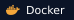

<!-- Live cards come from the "output" branch, rebuilt every 6 hours by .github/workflows/snake.yml.
     Static art in assets/ is generated by scripts/build_static.py. -->

 

<!--  -->

> 🧪 **Research lane** — computer vision · NLP · time-series forecasting · efficient AI for low-resource settings 
> ⚙️ **Engineering lane** — FastAPI · Docker · MLflow · DVC · DagsHub · CI/CD 
> 🏴‍☠️ **Crew code** — stay curious, build for real users, keep the pipeline reproducible

<table>
<tr>
<td width="24%" valign="middle"><b>🧠 AI / ML</b> models &amp; research</td>
<td valign="middle">
 
pandas · NumPy · Matplotlib · computer vision · NLP · time-series forecasting
</td>
</tr>
<tr>
<td width="24%" valign="middle"><b>⚙️ MLOps</b> shipping systems</td>
<td valign="middle">
 

 
CI/CD · model evaluation &amp; tracking · reproducible workflows
</td>
</tr>
<tr>
<td width="24%" valign="middle"><b>🧱 Backend / Data</b> APIs &amp; databases</td>
<td valign="middle">
 
REST APIs · relational data
</td>
</tr>
<tr>
<td width="24%" valign="middle"><b>🎨 Frontend</b> product &amp; UI</td>
<td valign="middle">

</td>
</tr>
<tr>
<td width="24%" valign="middle"><b>💻 Also code in</b> languages</td>
<td valign="middle">

</td>
</tr>
</table>

<table>
<tr>
<td width="50%" valign="top">

#### ⚡ [Bangladesh Electricity Demand Forecasting](https://github.com/estkayon/Bangladesh-Electricity-Demand-Forecasting-MLOps)
Time-series forecasting with a full MLOps delivery pipeline: versioned data, tracked experiments, a model API and an interactive dashboard. **Holdout MAPE `5.68%`** · **mean CV MAPE `4.89%`**.

</td>
<td width="50%" valign="top">

#### 🛒 [E-commerce Management System](https://github.com/estkayon/Ecommerce-Management-System)
Full-stack system for real business workflows: a Laravel MVC REST API (PostgreSQL, Sanctum auth, validation) powering a typed Next.js + TypeScript front-end.

</td>
</tr>
</table>

“The model is the start. The system is the mission.” ☠️

