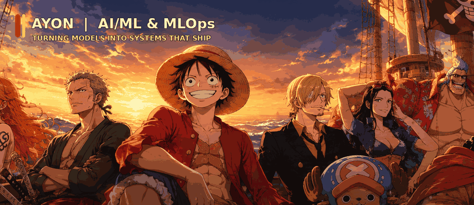
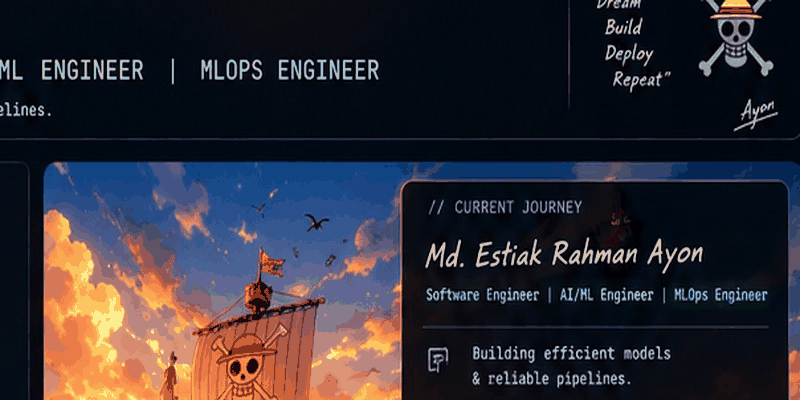
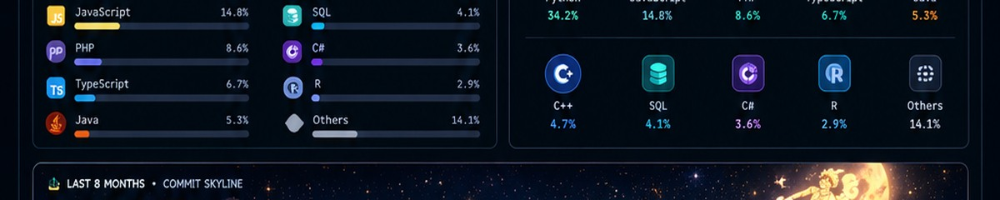

 <div align="center">
  

  # 𝙰𝚢𝚘𝚗

  ### SOFTWARE ENGINEER | AI/ML ENGINEER | MLOPS ENGINEER

  **Building efficient models & reliable pipelines.**

  <a href="https://estkayon.github.io/Portfolio/"></a>
  <a href="https://www.linkedin.com/in/md-estiak-rahman-ayon/"></a>
  <a href="https://github.com/estkayon"></a>
</div>


## 🧭 `CAPTAIN'S LOG`

<table>
<tr>
<td width="48%" valign="top">

```yaml
# Captain's profile

name: "Md. Estiak Rahman Ayon"
alias: "𝙰𝚢𝚘𝚗"
location: "Bangladesh"

role:
  - Software Engineer
  - AI/ML Engineer
  - MLOps Engineer

education:
  degree: "BSc in CSE"
  university: "AIUB"
  major: "Information Systems"
  cgpa: "3.54 / 4.00"
  status: "Graduate"

mission:
  - Build reliable ML systems
  - Automate model workflows
  - Develop practical APIs
  - Ship maintainable software

motto: "Dream. Build. Deploy. Repeat."
```

</td>
<td width="52%" valign="top">



```text
// CURRENT JOURNEY

CAPTAIN  : Ayon
COURSE   : Engineering & AI
MISSION  : Turn ideas into systems
COMPASS  : Build → Test → Deploy
NEXT STOP: New opportunities

STATUS   : Always learning
```

</td>
</tr>
</table>

---

## ⚓ `MAIN MISSIONS`

<table>
<tr>
<td width="50%" valign="top">

### ⚡ Electricity Demand Forecasting

**Bangladesh Electricity Demand Forecasting + MLOps**

A machine learning workflow for electricity demand forecasting, supported by an API, experiment tracking, data versioning and deployment tools.

- **Holdout MAPE:** 5.68%
- **Mean CV MAPE:** 4.89%
- **ML:** Python, forecasting, model evaluation
- **MLOps:** MLflow, DVC, DagsHub
- **Delivery:** FastAPI, Streamlit, Docker, GitHub Actions

<a href="https://github.com/estkayon/Bangladesh-Electricity-Demand-Forecasting-MLOps"></a>

</td>
<td width="50%" valign="top">

### 🛒 E-commerce Management System

A backend-focused e-commerce application built around maintainable architecture and structured data management.

- Laravel MVC architecture
- PostgreSQL database
- Sanctum authentication
- REST API development
- Organized application workflows

**Focus:** Clean code, secure authentication and maintainable backend services.

<a href="https://github.com/estkayon/Ecommerce-Management-System"></a>

</td>
</tr>
</table>


## 🧰 `STACK INVENTORY`

<div align="center">

### Languages · Frameworks · Tools


</div>

<details>
<summary><b>⌁ Explore my technical toolkit</b></summary>

| Area | Technologies |
|---|---|
| Languages | Python, C++, C#, JavaScript, TypeScript, PHP, R, SQL |
| AI / ML | PyTorch, TensorFlow, Scikit-learn, NumPy, pandas, Matplotlib |
| ML Engineering | MLflow, DVC, DagsHub, model evaluation, experiment tracking |
| Backend | FastAPI, Django, Laravel, ASP.NET, Node.js, REST APIs |
| Frontend | React, JavaScript, TypeScript, AJAX |
| DevOps | Docker, Kubernetes, GitHub Actions, CI/CD |
| Cloud & Systems | AWS, Linux |
| Databases | PostgreSQL, MySQL, MongoDB |
| Collaboration | Git, GitHub, GitLab, Claude Code, OpenAI Codex |

</details>

### Language share across public repositories


<sub>Repository language percentages represent detected code volume, not proficiency ratings. Values update through GitHub Actions.</sub>


## 🌊 `VOYAGE LOG`

<div align="center">

<a href="https://github.com/estkayon">
  
</a>

</div>

### 📈 Contribution activity · Last 8 months


### 🌃 The commit city

Every contributing day lights up the skyline. Taller buildings represent more contributions; the brightest day gets its own spotlight.


<div align="center">
  
</div>

<sub>Contribution charts are generated from GitHub activity. Active days and streak counts depend on the available contribution data and the configured generator.</sub>


## 🐍 `SNAKE GAME`

<div align="center">


</div>


## ☠️ `OPEN CHANNEL`

<div align="center">



<br />

<a href="https://github.com/estkayon"></a>
<a href="https://www.linkedin.com/in/md-estiak-rahman-ayon/"></a>
<a href="https://estkayon.github.io/Portfolio/"></a>

<br /><br />

*“As long as I live, there are infinite chances!”*

**— Monkey D. Luffy**

<br />

`DREAM`　•　`BUILD`　•　`DEPLOY`　•　`REPEAT`

</div>
